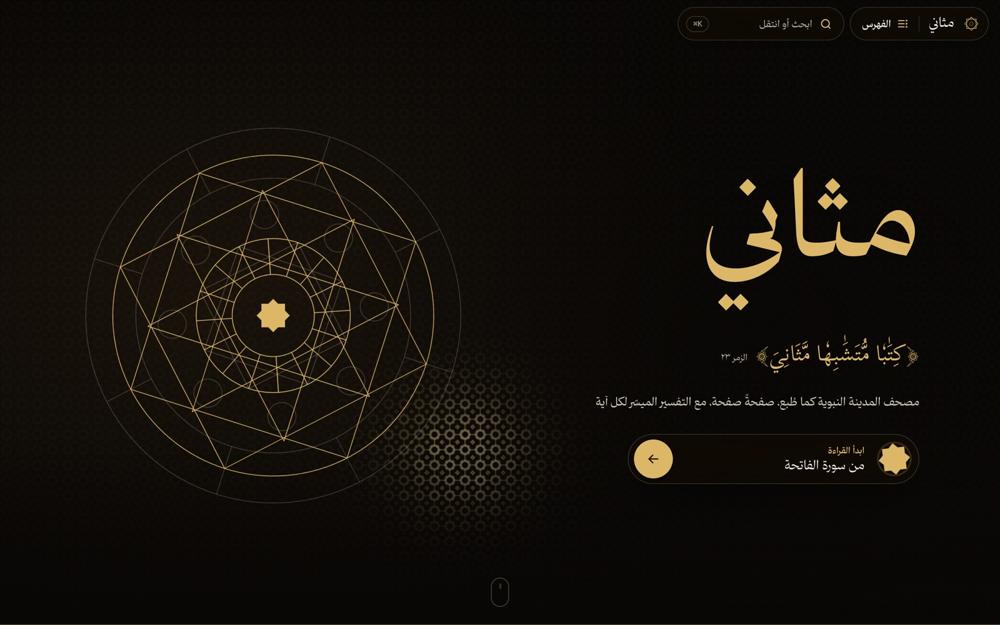
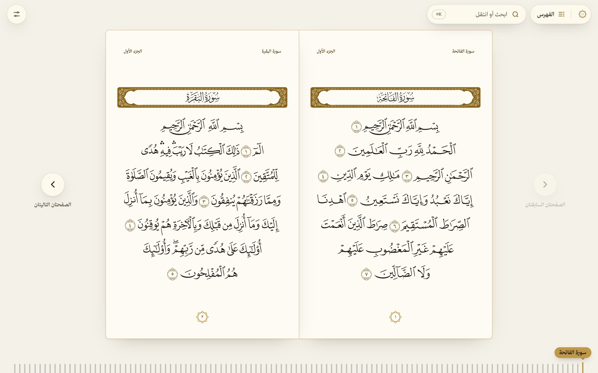
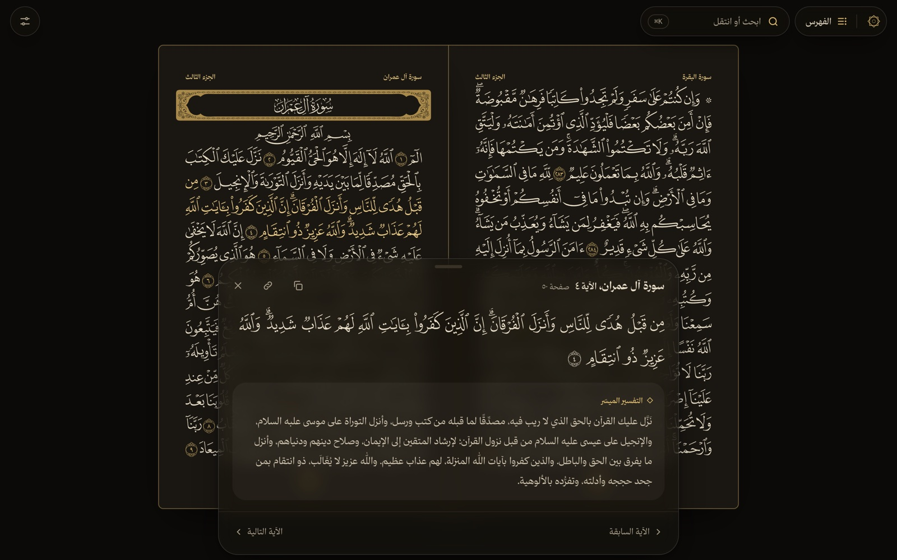
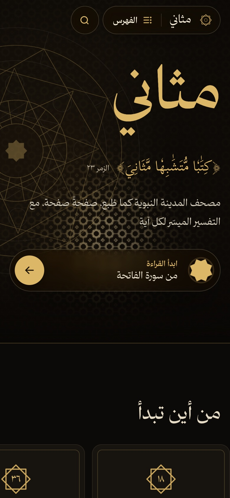
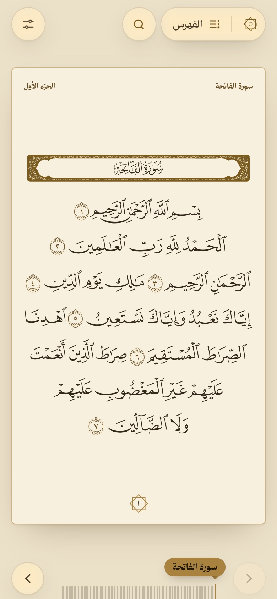

<p align="center">
  
</p>

<h1 align="center">مثاني · Mathani</h1>

<p align="center">
  The printed Madinah mushaf, page for page, with Tafsir al-Muyassar for every verse.<br>
  A fully static site: no server, no API calls, no accounts.
</p>

<p align="center">
  <a href="#run-it">Run it</a> &nbsp;·&nbsp;
  <a href="#deploy">Deploy</a> &nbsp;·&nbsp;
  <a href="#how-it-is-built">How it is built</a> &nbsp;·&nbsp;
  <a href="#credits">Credits</a>
</p>

<br>

> **﴿كِتَٰبٗا مُّتَشَٰبِهٗا مَّثَانِيَ﴾**
> <br><sub>az-Zumar 39:23</sub>
>
> The name is the Quran's own word for itself: a book read and returned to, again and again.

<br>

## Reading

<table>
  <tr>
    <td width="50%"></td>
    <td width="50%"></td>
  </tr>
  <tr>
    <td valign="top"><b>The pages as printed.</b> All 604 pages of the 1421 H Madinah edition, line for line, set in the King Fahd Complex page fonts. When the screen is wide enough, two pages open at one gilt spine, like a book.</td>
    <td valign="top"><b>Tafsir at a touch.</b> Tap any word for its verse and tafsir. The sheet steps from verse to verse, copies the text or a link to it, and leaves the page where it is.</td>
  </tr>
</table>

### The mushaf

- **Every page at its own address**, `/page/1` to `/page/604`, on a paper sheet edged by a single gilt rule, with its running head and page number printed on it.
- **Page turns like paper.** Turn with the arrows, <kbd>←</kbd> <kbd>→</kbd> or a swipe. In the open pair, the left page lifts at the spine and turns over onto the right. A single page slides away like a sheet off a stack, and the next one rises from beneath it.
- **The surah ruler.** All 114 surahs run along the bottom, one line each. The surah being read is the gold line, under a tag that names it. Point at a line to name its surah. Tap it, drag along the ruler, or step with the arrow keys or the wheel, and the mushaf turns there.
- **Verse ends in gold**, as printed mushafs mark them, so the eye finds where each verse ends.

### Two text views

- **متصل**: the Uthmani text as one continuous flow, with the page breaks marked.
- **آية وتفسير**: verse by verse, with the tafsir under each verse.
- **Tajweed colors** with a color key, laid over the same Uthmani text, so the letters never change.
- A surah link opens in whichever view the reader chose last.

### Finding your place

- **Search and jump** with <kbd>⌘K</kbd>, <kbd>Ctrl K</kbd> or <kbd>/</kbd> from any page. Type a surah name, a page number, a verse like `٢:٢٥٥`, a juz like `جزء ٣`, a hizb like `حزب ١٠`, or any word, and the matching verses appear as you type.
- **Verse search** at `/search` ignores diacritics, tatweel and the different forms of hamza and ta marbuta, so «الصلاة» finds «ٱلصَّلَوٰةَ».
- **The index** lists every surah with its page. Filter it by name or by Makki and Madani, or group it by juz.
- **Continue reading** remembers the last verse you opened. On the home page, a ring shows how far into the mushaf that is.

### Comfort

- **Four themes**: automatic, light, sepia and dark. One slider sets the text size, and it scales the mushaf page too.
- **Remembered per browser** and applied before the first paint, so nothing flashes.
- **Keyboard shortcuts**: press <kbd>?</kbd> anywhere for the full list, grouped by where each one works.
- **Reduced motion respected.** Under `prefers-reduced-motion`, every animation stands down.

<br>

## On a phone

<table>
  <tr>
    <td width="50%" align="center"></td>
    <td width="50%" align="center"></td>
  </tr>
  <tr>
    <td valign="top">The cover keeps the gilt rosette behind the title. The six places most readers begin become a row you flick through.</td>
    <td valign="top">One page fills the screen in the printed 1 : 1.6 proportion. The header steps away while you read and returns when you scroll up.</td>
  </tr>
</table>

<br>

## Design

**Tadhhib, the art of the illuminated mushaf.** A dark bound cover, warm ivory paper, gold leaf for ornament, and the eight-pointed star of the rub' al-hizb as the one recurring mark. That star holds every number on the site.

| | |
|---|---|
| **Cover** | A live WebGL lattice of eight-pointed stars, lit by a lamp that follows the pointer, and a rosette that draws itself in |
| **Type** | Thmanyah Serif Text for the interface and the tafsir, Thmanyah Serif Display for titles and surah names, Scheherazade New for the Quran in the text views, and the 604 King Fahd Complex fonts for the pages |
| **Motion** | GSAP for the cover's opening, scroll reveals, count-ups, the page turn and the surah filter. CSS transitions for the panels and the verse sheet. View Transitions for moving between pages, plus a circular reveal when the theme changes |

**Before and after.** [`src/styles/unslop.css`](src/styles/unslop.css) is a polish pass laid over the original styles under `html.after`. It changes the gold effects, labels, weights, spacing, radii and some motion. A small **قبل / بعد** switch pinned to the foot of every page ([`Compare.astro`](src/components/Compare.astro)) flips between the two looks, and each browser remembers its choice. To keep the after look for good, fold its rules into their own stylesheets and remove `<Compare />` from [`Base.astro`](src/layouts/Base.astro).

<br>

## Run it

Requires Node.js 22.12 or newer.

```bash
npm install
npm run dev        # http://localhost:4321
npm run build      # static output in dist/
npm run preview    # serve the built site
```

Bun works too (`bun install`, `bun run dev`).

## Deploy

In Vercel, choose **Add New → Project**, import [`viasaud/mathani`](https://github.com/viasaud/mathani), and press **Deploy**. Vercel detects Astro on its own (build command `astro build`, output `dist`). No environment variables are needed.

From the terminal, use `npx vercel` for a preview and `npx vercel --prod` for production.

The sitemap and canonical links use Vercel's production domain automatically. For a custom domain, set `SITE_URL` (for example `https://quran.example.com`) in the project's environment variables and redeploy.

<br>

## How it is built

| | |
|---|---|
| **Framework** | [Astro](https://astro.build), fully static: 604 mushaf pages, 114 surah pages, search, sitemap and robots.txt |
| **Data** | Everything is bundled in `data/`: Uthmani text, tafsir, tajweed ranges, search text, and where every word sits on the printed page |
| **Page fonts** | Loaded per page from jsDelivr, pinned to one commit and cached for a year. Each page preloads its own font and prefetches the next |
| **Motion** | GSAP 3, native View Transitions, WebGL 2 with a still fallback |

```
data/                    Quran text, tafsir, tajweed and search text: one JSON file per surah, plus chapters.json
data/layout/             Where every word sits in the printed mushaf: glyph code, page, line
docs/screens/            The screenshots in this file
scripts/fetch-quran.mjs  Re-downloads data/ from the quran.com API
src/
  pages/index.astro      Home: cover, continue reading, where to begin, the juz, the surahs
  pages/page/[n].astro   One static page per mushaf page (604 pages)
  pages/surah/[id].astro One static page per surah (114 pages), for the two text views
  pages/search.astro     Verse search; reads /search.json (built from data/)
  pages/index.json.ts    Surah list and the first verse of every page, juz and quarter, for the index, palette and ruler
  layouts/Base.astro     Shell: header, settings, index, palette, shortcuts; saved settings applied before first paint
  components/            Star mark, verse sheet, surah text (both views), tajweed key, before/after switch
  lib/                   Data access and page layout (quran.ts), the shared index, verse sheet, search folding, helpers
  scripts/shell.ts       Every page: header, index, palette, settings (theme reveal), shortcuts
  scripts/motion.ts      Every page: segment pill, scroll reveals, count-ups, the cover's opening
  scripts/home.ts        Home: the cover's header tone, the continue-reading ring, current juz, surah filter, back to top
  scripts/cover-gl.ts    Home: the WebGL gilt lattice behind the cover
  scripts/page.ts        Mushaf page: verse sheet, page turns, the surah ruler, line balancing, last-read memory
  scripts/reader.ts      Text views: verse sheet, copy, header page and juz, last-read memory
  styles/global.css      Tokens for the four themes and the cover, motion tokens, tajweed colors, shared components
  styles/home.css        The home page
  styles/reader.css      The mushaf page and the two text views
  styles/unslop.css      The after look, laid over the rest (see Design)
```

<details>
<summary><b>Notes on the data</b></summary>
<br>

- The verse row format is documented in `VerseRow` in `src/lib/quran.ts`.
- Some tafsir entries explain several verses together. The later verses in such a group hold the index of the verse that carries the text, and the site shows the tafsir once, with its verse range.
- A few words in the page-layout data sit one line too early (pages 27 and 177, for example). The page script spots a line that overflows next to a short one and moves the word back. It also centers the lines that are short by design, such as the last surahs on page 604.
- The page fonts come from `cdn.jsdelivr.net/gh/nuqayah/qpc-fonts@<commit>/mushaf-v2/`, so they add nothing to the deployment. To self-host them instead, put the 604 files in `public/` and change `fontUrl` in `src/pages/page/[n].astro`.
- The API's own tajweed text uses slightly different code points from the Uthmani text (for example ٲ for the dagger alef). The data script aligns the two and stores each rule as a character range on the Uthmani text.

</details>

### Refresh the data

```bash
npm run fetch-data
```

<br>

## Credits

- **Mushaf page fonts** (V2) and the surah header font by the King Fahd Glorious Quran Printing Complex. They are free to use and distribute, but not to sell or modify. The page fonts are served from [nuqayah/qpc-fonts](https://github.com/nuqayah/qpc-fonts).
- **Quran text, tajweed and Tafsir al-Muyassar** from the [quran.com](https://quran.com) API.
- **Scheherazade New** by SIL International, under the SIL Open Font License, self-hosted through Fontsource.
- **Thmanyah Serif** (Text and Display) by Thmanyah, in `public/fonts/thmanyah/`.
